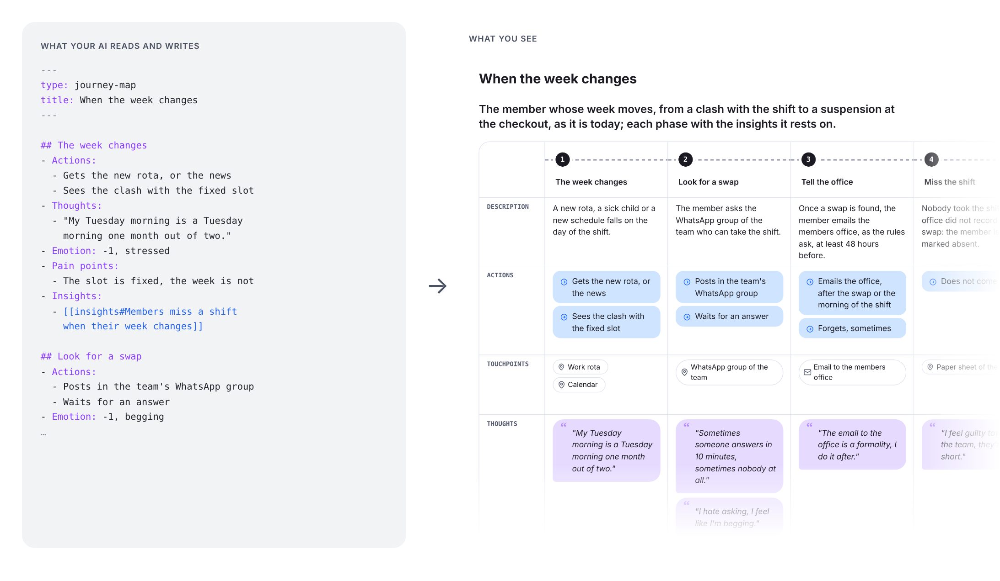
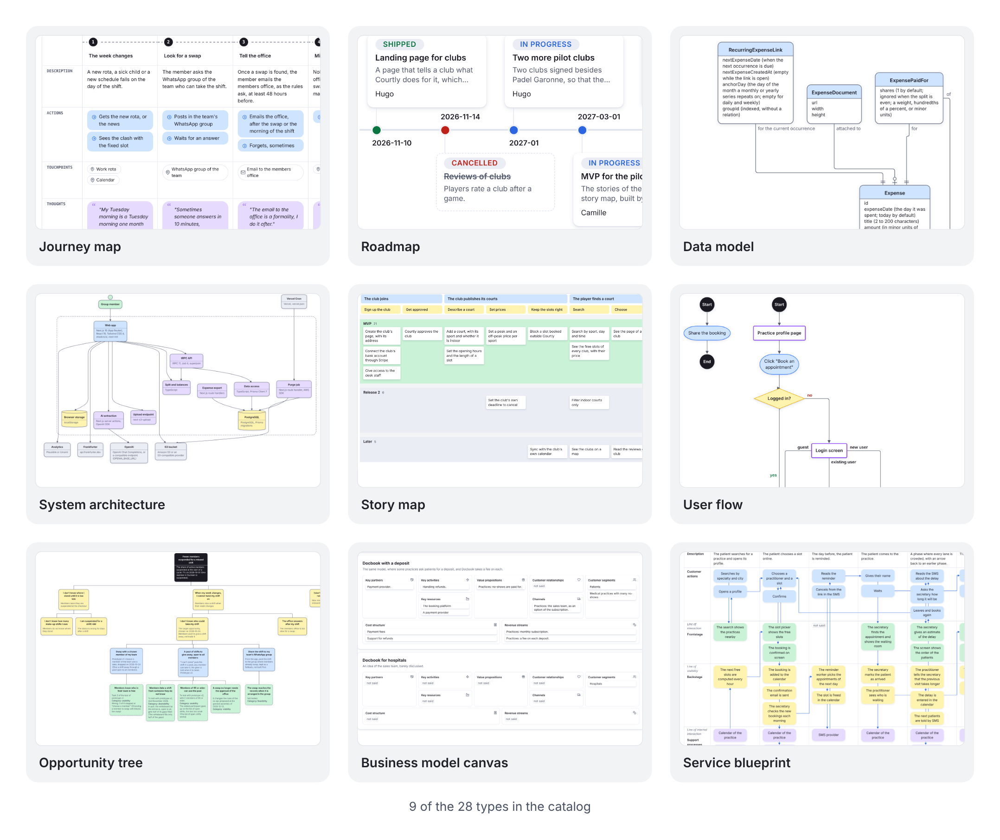
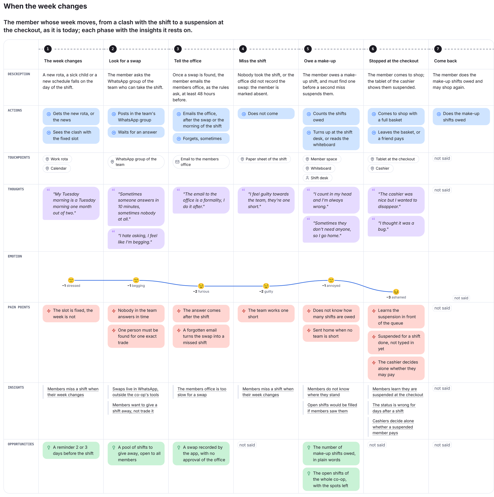
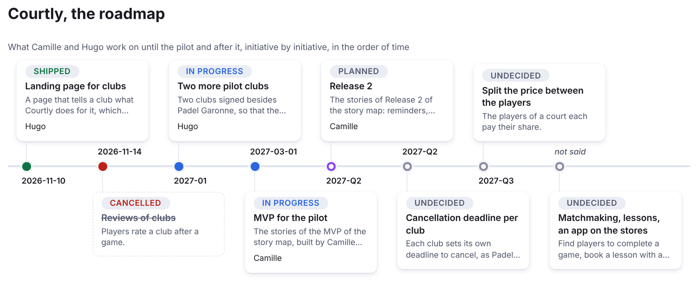
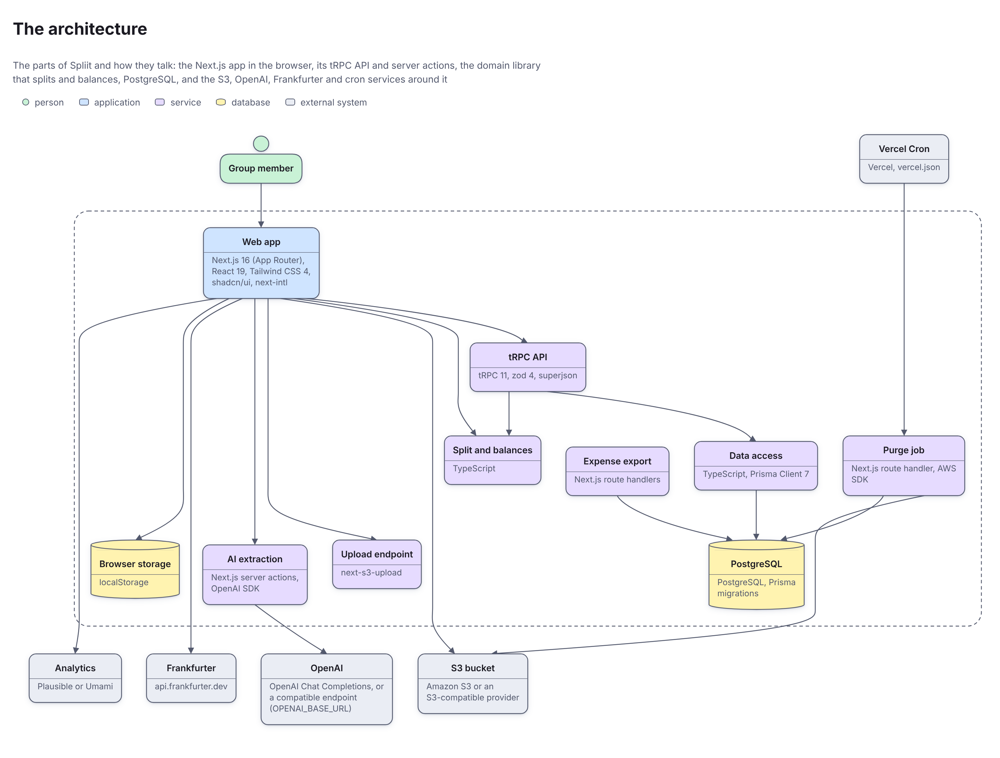

# maps.md

[](https://github.com/florentbx/maps.md/actions/workflows/ci.yml) [](LICENSE)

**Your AI's context, made visual.**

Work with your AI visually, not through walls of text: it writes maps in Markdown, you see them drawn and edit them, and it reads them back as its context.

[Get started](#get-started) · [Live demo](https://florentbx.github.io/maps.md/showcase.html) · [Examples](#examples) · [Our maps](#our-maps) · [Documentation](#boring-documentation) · [Feedback](#feedback-and-contributions)

<picture>
  <source media="(prefers-color-scheme: dark)" srcset="maps/images/markdown-to-map-dark.png">
  
</picture>

## Get started

**Try it first, nothing to install**: [see the examples drawn](https://florentbx.github.io/maps.md/showcase.html), as your maps would be.

In the folder of your project (Node 22 or later):

```bash
npx github:florentbx/maps.md#semver:^0
```

Then ask your AI anything, for example:

```text
Map the architecture of this project.
Show me the map.
```

It writes the map in `maps/` and shows it to you, drawn. Click **Edit** to change it.

<picture>
  <source media="(prefers-color-scheme: dark)" srcset="maps/images/maps-landscape-dark.png">
  
</picture>

## What it is for

A map is a Markdown file that your AI writes and the page draws: any context you want to see, a journey, a data model, a roadmap, a glossary, a pile of notes. A catalog of 28 types is there to start from, and your AI creates the type you want when none fits.

Maps link to each other: a journey cites the insights it comes from, a screen the step of the flow it serves. Your AI follows these links as you do, so a fact is written once. Your maps live in your repository, next to the code.

For example:

- **From an idea to a working app**: the brief, the flows, the screens and the rules, as maps your AI builds the app from.
- **UX as context**: your research, journeys and personas in the repository, a UX repository that the people and the AIs who build read.
- **Make sense of a large context**: an existing codebase or a pile of documents, mapped so that you can see it (its architecture, its data, its rules).

And any other context worth sharing with your AI.

## Examples

Three maps from the examples in `showcase/`; a map can be written from another, and link to it.

**UX: a journey map**, from research: what a person does, thinks and feels, phase by phase, where it goes wrong, and the insights each phase rests on. "Make a journey map from these insights."

<picture>
  <source media="(prefers-color-scheme: dark)" srcset="maps/images/example-journey-dark.png">
  
</picture>

**Product: a roadmap**, from notes or a backlog: the initiatives in the order of time, each with where it stands, when and who carries it. "Make the roadmap of the next two quarters from these notes."

<picture>
  <source media="(prefers-color-scheme: dark)" srcset="maps/images/example-roadmap-dark.png">
  
</picture>

**Technical: a system architecture**, from the code: the parts of the app, what each one runs on and how they talk. "Map the architecture of this codebase."

<picture>
  <source media="(prefers-color-scheme: dark)" srcset="maps/images/example-architecture-dark.png">
  
</picture>

[See the examples drawn](https://florentbx.github.io/maps.md/showcase.html), with nothing to install: three projects, each with its own types, `1-courts/` (a product manager vibe-codes a marketplace), `2-spliit/` (an open-source app, mapped from its code) and `3-coop/` (the UX research of a food co-op).

## Our maps

The maps of maps.md are in `maps/`: [getting started](maps/getting-started.md) (a user flow), [its architecture](maps/architecture.md), [its value](maps/value.md) and [the journey of a designer who vibe-codes](maps/journey.md). [See them drawn](https://florentbx.github.io/maps.md/maps.html).

## Yours to shape

Nothing in maps.md is tied to a type. The format says how any map is written; each type brings its definition, its layout and its style; the page draws them all the same way, as it knows shapes (cards, a sequence, a graph, a tree), never a type.

- **A type**: change its properties, its views (a board, a table, a matrix…), its look in free CSS; or make a new one for what you map.
- **The page**: one `theme.css` of design tokens (colors, fonts, sizes, radii) gives every map the look of your brand.

## Yours, in plain Markdown

Your maps are plain Markdown files in your repository, not records in a tool.

- **Yours**: no account, no server, nothing to lock you in. Readable in any editor, on GitHub, by any AI; versioned and reviewed with your code. If maps.md stopped tomorrow, your maps would stay as they are.
- **Flexible**: what a map says is apart from how it is drawn. The same file can be shown as a board, a table or a matrix, and take your brand's theme, without a word changed.

## Next to other diagram tools

Mermaid draws what you already know; maps.md holds what you and your AI know, and what you don't yet, and draws it.

| Tools | Next to maps.md |
| --- | --- |
| **Mermaid**, PlantUML, D2 | Text to a diagram: a type is a way of drawing, and a box holds a label. In maps.md, a type is a meaning (what an element is, what each property means), which your AI reads and the check verifies; the drawing follows from it. |
| **Miro**, FigJam, Excalidraw | Drawn by hand, for people: your AI can hardly read them or write them, and they live outside the repository. |

## Boring documentation

### How it fits together

- **The format**: Markdown files, each with a type. It is the heart of maps.md, readable without it ([`FORMAT.md`](FORMAT.md)).
- **The renderer**: it draws any map from its shape (cards, a sequence, a graph, a tree), never from its type.
- **The page**: `maps.html`, one file that shows and edits the maps of a folder. It is only one way to see the maps: it can change, or be replaced by another, without touching the format, the types or your maps.

### Maps and types

Every map has a type (`type: journey-map`). The type says what the map holds: its elements, their properties, the values allowed. Your AI reads it to write the map, and the check holds the map to it. The layout and the style of the type say how the page draws it.

The types of your project are in `maps/types/`, next to your maps: plain files, yours to change.

- **A catalog of 28 types** (journey map, user flow, ERD, roadmap…) comes with the skill: ask for a map, your AI picks the type that fits and copies it into `maps/types/`.
- **A type does not suit you**: ask your AI, or change its files in `maps/types/` yourself: structure or look.
- **None fits**: your AI creates one in `maps/types/`. It writes a definition, a layout, and, if wanted, a style in free CSS.

Ask your AI: "make a type for our hiring pipeline", "add an owner to each step of the journey map". A type is up to three files in `maps/types/`:

- **`<type>.md`, the definition**: the shape (cards, a sequence, a graph or a tree), what an element is called, its properties and the values allowed. Your AI reads it to write the maps, and the check holds them to it.
- **`<type>.layout.md`, the layout**: the views of the map (a board, a table, a matrix…) and how they are drawn, such as the color of a box by its status.
- **`<type>.css`, the style**, if wanted: its look in free CSS, made of the design tokens of the page.

A type of the catalog is copied into `maps/types/` before it is changed. Your AI follows `create-type.md` and `create-style.md`, next to the skill: it proposes, you decide.

### Links between maps

A map links to another with `[[map]]`, or to one of its elements with `[[map#Element]]`: a journey cites the insights it comes from, a screen the step of the flow it serves. Your AI follows the links as you do, so a fact is written once. In the page, a click on an element shows the maps that cite it; the check flags a link that points nowhere, and `rename.mjs` renames an element without breaking the links to it.

### Open your maps

What `npx github:florentbx/maps.md#semver:^0` sets up: the skill and its catalog of types in `.claude/skills/maps/`, the page in `maps/maps.html`, the preview `maps` in `.claude/launch.json`, and the line in `CLAUDE.md` and `AGENTS.md` (it creates both if you have neither). Your own types go in `maps/types/`.

Every way to open them:

| Your project folder is | You work in | Open your maps | Edit them in the page | A change by your AI shows |
| --- | --- | --- | --- | --- |
| On your computer | The Claude desktop app, a local session | The preview `maps`: your AI shows it as soon as it has written a map. Nothing to run. | Yes | At once |
| On your computer | A terminal, VS Code, or any AI that runs commands on your computer | `node .claude/skills/maps/serve.mjs maps/`, then open the address it prints | Yes | At once |
| On your computer | A browser only | Open `maps/maps.html`, click **Open a folder**, choose `maps/` | In Chrome and Edge; read only in the others | When you open the folder again |
| In a container | A cloud session (Claude Code on the web, or a cloud session in the app) | Ask your AI to publish the maps as a private artifact | Yes: kept in the artifact, your AI writes them into the files when you ask, or when it publishes again | When you ask again |

**Common surprises** (another one? [tell us](https://github.com/florentbx/maps.md/issues/new))

- **The button reads Markdown, not Edit, and the Markdown says `Read only`**: the page cannot write the file. You may only view the artifact (ask who shared it), or you opened `maps.html` in a browser other than Chrome or Edge.
- **Your AI gives an address in a cloud session** (`127.0.0.1`, `localhost`): it is the remote machine, not yours, and it cannot open. Ask for the private artifact.
- **No preview `maps` in the desktop app**: the session is a cloud one, or maps.md was not installed in this project.
- **A change by your AI does not show**: in the browser, open the folder again; with an artifact, ask your AI to publish it again.
- **The editor says `Not saved: the map changed meanwhile`**: your AI changed the map since the page read it. The file keeps your AI's change; what you typed stays in the editor, not saved. Copy it if you want it, then reload the page (in the browser, open the folder again): the editor shows the map as your AI left it.

### In the page

The files are on the left, the map in the middle: a click on an element or a value shows its details in the panel on the right, with the maps that cite it and the sources of its facts. **Edit**, in the bar, opens the Markdown of the map there; in the Markdown, type `[[` to write a link: a list proposes the maps, their elements, and the values the type allows. **N to fix** lists what the check finds wrong.

A map may end with **open questions**: what its sources left open, and what your AI assumed. To answer one, tell your AI ("the guest booking: yes, decided with Inès"): it adds the decision, with who decided and when. While the open questions are in the panel, what they are about stands out on the map.

To share the maps, ask your AI to publish them as a private artifact and share its link; to share one map, the export button downloads it as a **PNG image**.

To give the maps the look of your brand, ask your AI: it writes a `theme.css` in `maps/` (the design tokens of the page) or the style of a type, `maps/types/<type>.css`, following `create-style.md`, next to the skill.

### Check your maps

```bash
node .claude/skills/maps/check.mjs maps/
```

It checks every map against its type (values, arrows, names, links), says the file and line of each problem, and fails on an error, so it can run in CI; your AI runs it after writing a map. It also writes, at the top of each map, the comment that tells an AI how to read it. To rename an element without breaking the links to it, your AI runs `rename.mjs`, next to the skill. `shot.mjs` (`node .claude/skills/maps/shot.mjs maps/`) takes a picture of every map, for your AI to look at what it drew; it needs Playwright.

## Feedback and contributions

Something does not work, or a type is missing? [Open an issue](https://github.com/florentbx/maps.md/issues/new).

Want to help? Contributions are very welcome, small ones too: a new type for the catalog, a fix, an example, a clearer sentence in the docs. Open an issue to share an idea.

## License

MIT, see `LICENSE`.
